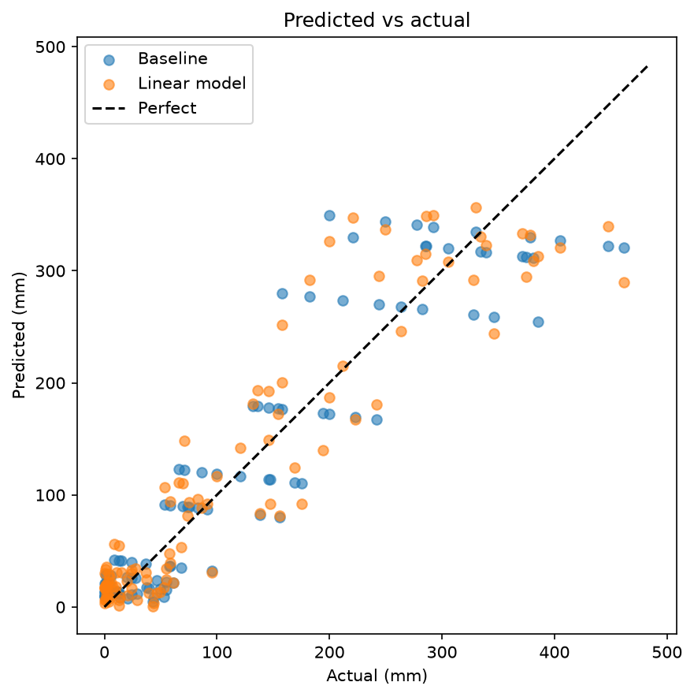
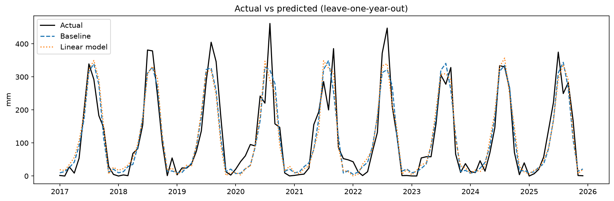

# Rainfall Predictability Analysis over Odisha

Can past rainfall predict Odisha's monthly rainfall better than a simple seasonal average?
**Short answer: no.** A lag-feature regression did not beat the climatology baseline.

## Data
IMD 0.25° gridded daily rainfall, 2016–2025 (3,653 days, 120 months).
- Source: India Meteorological Department (IMD) gridded rainfall dataset
- Raw `.grd` files are not included. Download them from IMD
- Processed monthly series: `Data/odisha_monthly_rainfall.csv`

## Method
1. Average all grid cells inside a lat-lon box over Odisha (17.8–22.6°N, 81.3–87.5°E) for each day, then sum to monthly totals.
2. Quality checks: 0 missing days, no negative values.
3. Baseline: average rainfall for each calendar month (climatology).
4. Model: linear regression on lag-1 and lag-12 rainfall anomalies.
5. Evaluation: leave-one-year-out cross-validation over 9 held-out years.

## Results
| Model | MAE (mm) |
|---|---|
| Climatology baseline | 34.4 |
| Lag-feature regression | 34.5 |

The model beat the baseline in 4 of 9 held-out years. Past rainfall alone carries little forecast skill.




## Limitations
- The box is a rough rectangle, not the state boundary.
- Only 120 months of data, and only lag features were used.
- Leave-one-year-out CV trains on years after the test year, which is looser than a true forecast.

## Next steps
- Add ENSO (Niño 3.4) and IOD indices as predictors.
- Try tree-based models.
- Use an Odisha shapefile mask.
- Predict June–September seasonal totals.

## How to run
```bash
pip install -r requirements.txt
jupyter notebook Notebook/Rainfall_Predictability_Analysis.ipynb
```
Open the notebook from the `Notebook` folder. Section 1 needs the raw `.grd` files in `Data/`. Without them, skip section 1 and run from section 2, which reads the CSV.

## Author
Devashish Arora, NIT Rourkela
